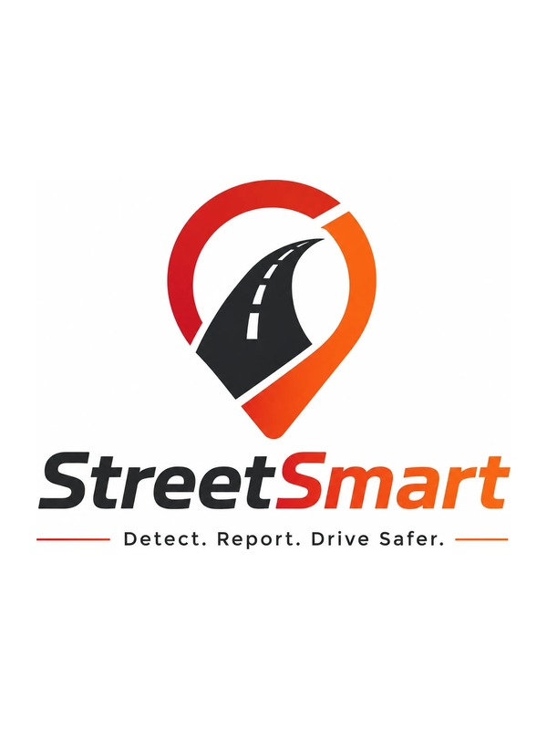

<p align="center">
  
</p>

<h1 align="center">StreetSmart</h1>

<p align="center">
  <strong>Every commute is a road survey.</strong><br />
  Your phone already feels every pothole. StreetSmart turns that into a safer, self-healing road map, and a direct line to the people who can fix it.
</p>

<p align="center">
  <a href="#the-problem">Problem</a> ·
  <a href="#what-it-does">Features</a> ·
  <a href="#see-it-in-60-seconds">Demo</a> ·
  <a href="#quick-start">Run it</a> ·
  <a href="#how-its-built">Architecture</a> ·
  <a href="#roadmap">Roadmap</a>
</p>

---

## The problem

Potholes damage vehicles, drain household budgets, and cause accidents. Yet cities still find them the slow way: someone notices, someone complains, someone fills out a form. By the time a report is filed, hundreds of drivers have already hit it.

## The idea

A smartphone mounted on a dashboard already carries an accelerometer, a gyroscope, and GPS. **No extra hardware is needed.** StreetSmart reads those sensors in real time, recognizes road hazards on the device itself, and closes the loop between the driver who feels the problem and the city that can repair it.

```
 phone sensors ──▶ on-device detection ──▶ crowd-verified hazard map
                                              ├──▶ warns nearby drivers
                                              ├──▶ files civic repair reports
                                              └──▶ verifies the fix when the road runs clean
```

## What it does

### Senses
- **Passive detection.** Reads the accelerometer and gyroscope at ~50 Hz alongside 1 Hz GPS, entirely on-device.
- **Mount-independent.** Readings are rotated into the vehicle's own frame, so detection works however the phone is tilted or placed.
- **Speed-aware.** Impacts are normalized for speed, so a jolt at 20 mph is judged fairly against one at 40.
- **Understands context.** Classifies each event as a pothole, speed bump, or rough road, with severity and confidence scores.

### Thinks
- **Heuristics vs. AI.** A rule-based detector and a trained neural classifier run on the same sensor window, with an in-app lab to compare them side by side.
- **Runs offline.** The neural network executes inside the app as a pure-JavaScript forward pass, so detection never needs a connection.

### Warns
- **Crowd consensus map.** One reading is a hint; many drivers are evidence. Confirmations raise a hazard's confidence, clean passes lower it, and stale hazards fade on their own with no moderators.
- **Proximity alerts.** Spoken and haptic "pothole ahead" warnings as you approach a verified hazard.
- **Hazard-aware navigation.** Turn-by-turn routing that scores alternative routes by hazard exposure, offers an "avoid rough roads" mode, and reroutes automatically if you leave the path.

### Reports
- **Crowd-gated civic reporting.** Hazards become eligible for submission only after enough independent drivers corroborate them.
- **Open311-style lifecycle.** Reports move from filed, to under review, to resolved, with photos and status tracking in **My Reports**.
- **City review queue.** Reviewers get an evidence-backed list instead of vague complaints.

### Respects privacy
- **Trip endpoints are trimmed**, so homes and destinations are never exposed.
- **k-anonymity gates** suppress areas with too little data before anything is shared.

### Engages
- **Leaderboards** for hazards reported and potholes confirmed.
- **In-app notifications** when a report you filed changes status.

## See it in 60 seconds

No road trip required. The app's **Demo drive** replays a route through the *real* detection engine in real time: speed climbs, jolts fire, the phone buzzes, and severity-colored pins land on the map.

1. Open the app and tap **Demo drive (simulated)**.
2. Watch potholes and a speed bump get detected and classified live.
3. Review the map, tap a pin, and confirm a detection.

A full recording playbook lives in [docs/DEMO.md](docs/DEMO.md).

## Quick start

**Requirements:** Node.js 20+, [pnpm](https://pnpm.io) 9, and [Expo Go](https://expo.dev/go) on your phone (iOS or Android).

```bash
git clone https://github.com/Eeeeepppp11/StreetSmart.git
cd StreetSmart
corepack enable
pnpm install
pnpm build
```

Add your Firebase web config (see `apps/mobile/.env.example`), then launch:

```bash
cd apps/mobile
cp .env.example .env      # fill in your Firebase values
pnpm exec expo start      # scan the QR code with Expo Go
```

If your network blocks LAN discovery, use `pnpm exec expo start --tunnel`.

### Run the tests

```bash
pnpm build && pnpm test
```

> Build before testing: each package's tests run its compiled output.

## How it's built

StreetSmart is a TypeScript monorepo (pnpm + Turborepo). Every logic package is **pure and deterministic**: no hidden clocks or randomness, so the whole engine is reproducibly testable.

| Package | Role |
|---|---|
| `apps/mobile` | React Native (Expo) app: sensing, map, alerts, reporting |
| `apps/dashboard` | Next.js public road-quality scorecards |
| `packages/detector` | On-device detection core: reorient, extract features, classify |
| `packages/proximity` | "Pothole ahead" alert engine |
| `packages/geo` | H3 hexagonal spatial indexing, distance and bearing |
| `packages/privacy` | Trip-endpoint trimming and k-anonymity gates |
| `packages/shared-types` | Shared wire and domain types |
| `services/ingestion` | Batched event intake server |
| `services/hazard-engine` | Confidence scoring and self-healing hazard tiles |
| `services/routing` | Hazard-aware route scoring |
| `services/civic` | Open311 / SF311 mapping and fix verification |
| `services/analytics` | Scorecards and privacy-gated exports |
| `ml/` | Python training, TFLite export, and model registry |

Highlights:

- **H3 spatial index** for hazards, the same hexagonal grid system used by large-scale mapping platforms.
- **Replaceable externals.** Routing engines and civic backends sit behind adapters, so Mapbox can become a self-hosted router and SF311 can become any Open311 city.
- **One shared vocabulary** from phone to dashboard, defined once in `shared-types`.

Full design and decision log: **[docs/ARCHITECTURE.md](docs/ARCHITECTURE.md)**.

## Roadmap

- Background sensing through a native module for hands-off, always-on detection at 100 Hz.
- On-device TFLite acceleration.
- Real-drive replay harness for continuous model regression testing.
- Additional Open311 city adapters beyond the San Francisco pilot.
- Municipal and insurer data exports, built on the existing privacy gate.

---

<p align="center"><em>Every commute is a road survey.</em></p>
