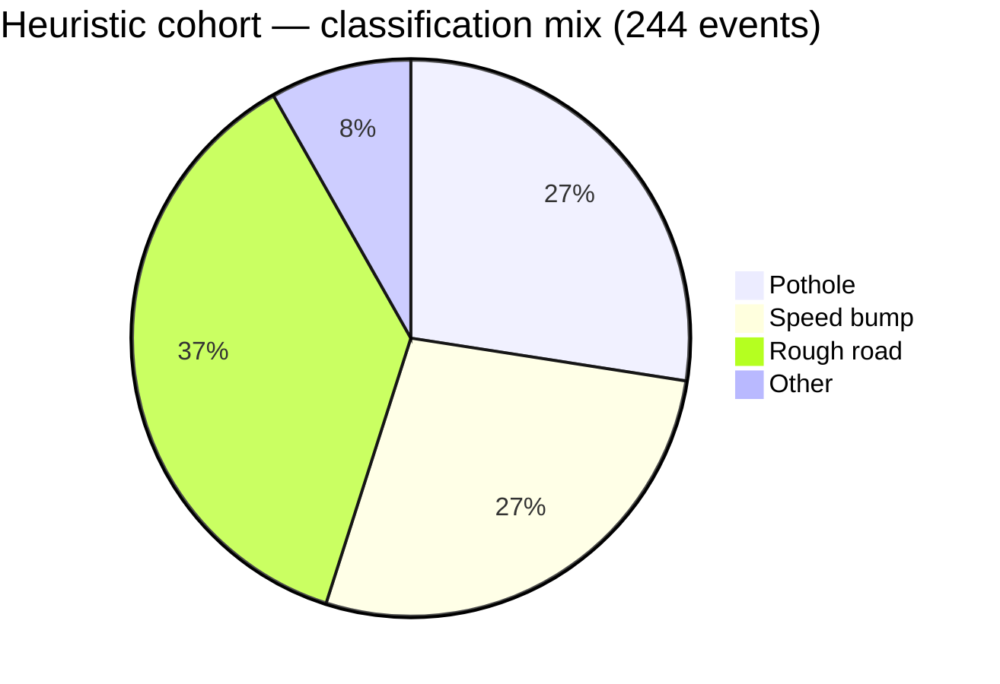
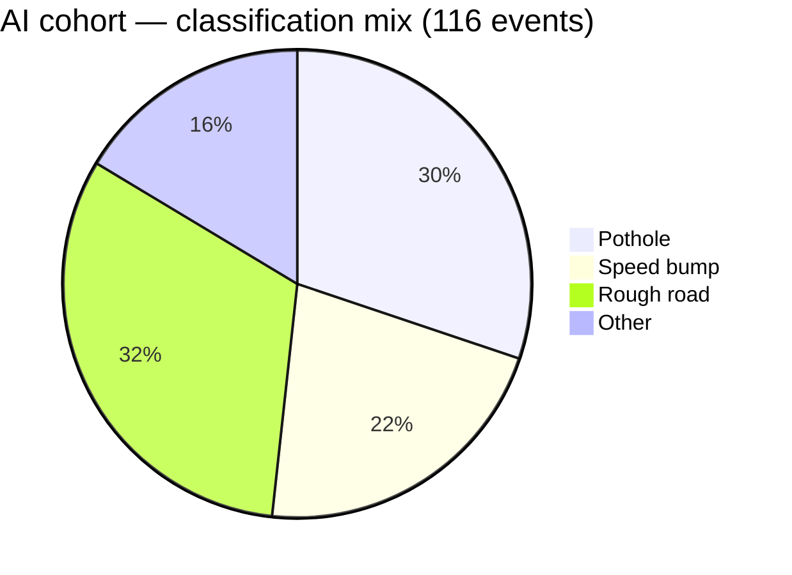

# Demo cohort report — 15 drivers, heuristic → AI model

Generated 2026-08-20. Reference doc for the demo dataset seeded into Firestore
for judge/demo purposes. Interactive version (charts, sortable-feeling
layout): see the published artifact link shared alongside this file.

**None of this represents real users or real drives.** All 15 accounts are
synthetic demo accounts; all events are synthetic sensor windows. See
[Methodology](#methodology) for exactly what's real vs. fabricated.

## Summary

| | |
|---|---|
| Total drivers | **15** |
| Total drives | **80** |
| Total events | **360** |
| Heuristic cohort | 10 drivers · 51 drives · 244 events |
| AI cohort (`mlp-v1-synthetic`) | 5 drivers · 29 drives · 116 events |
| Location | West Bellevue, WA (zip 98005), anchored to real 311 report coordinates |
| Demo account password | `PotholeDemo2026!` (all 14 seeded accounts) |

The **heuristic cohort** (first 10 accounts, seeded earlier) ran on the
Phase-1 hand-tuned threshold classifier. The **AI cohort** (5 newest
accounts) ran on the trained MLP (`mlp-v1-synthetic`) — every one of their
events is the actual output of `classifyWithModel` against a real extracted
feature vector, not a fabricated number.

## Driver roster

Sorted by events detected.

| Driver | Email | Cohort | Drives | Events |
|---|---|---|---:|---:|
| Aayan Hetamsaria | aayan.hetamsaria@outlook.com | Heuristic | 10 | 41 |
| Aaryaman Chopra (you) | aaryamanchopra25@outlook.com | Heuristic | 2 | 41 |
| Jeffery Lou | jefferylou7@gmail.com | Heuristic | 9 | 35 |
| Lucas Zhang | lucas.zhang92@gmail.com | Heuristic | 7 | 35 |
| Alex Lee | alexlee2025@gmail.com | **AI model** | 6 | 32 |
| Jack Oliveira | jack.oliveira@gmail.com | **AI model** | 9 | 31 |
| Ian Tang | ian.tang24@gmail.com | **AI model** | 7 | 28 |
| Aren Loving | aren.loving@outlook.com | Heuristic | 5 | 20 |
| Wynston Su | wsu2024@gmail.com | Heuristic | 6 | 20 |
| Corwin Su | corwin.su@gmail.com | Heuristic | 4 | 17 |
| Raghav Chaturvedi | raghavc19@gmail.com | Heuristic | 3 | 16 |
| Pradyun Vancha | pvancha7@outlook.com | **AI model** | 4 | 15 |
| Hennry Lou | hennry.lou@outlook.com | Heuristic | 2 | 11 |
| Andrew Chen | andrewchen.dev@outlook.com | **AI model** | 3 | 10 |
| Rui Sun | ruisun@outlook.com | Heuristic | 3 | 8 |

## AI model performance (`mlp-v1-synthetic`)

Real evaluation results from the actual training run
(`ml/training/artifacts/metrics.json`, synced into the app via
`ml/export/sync_to_app.mjs` — see `packages/detector/src/model.metrics.ts`).

| Metric | Value |
|---|---|
| Architecture | 10 → 32 → 16 → 4 MLP, ReLU / softmax |
| Test accuracy | **91.1%** |
| Pothole false-positive rate | **2.3%** |
| Training examples | 8,400 (5,880 train / 1,260 val / 1,260 test) |

### Per-class performance

| Class | Precision | Recall | F1 |
|---|---:|---:|---:|
| Pothole | 94% | 98% | 96% |
| Speed bump | 96% | 97% | 96% |
| Rough road | 89% | 82% | 85% |
| Other | 82% | 85% | 83% |

### Confusion matrix

Rows = actual, columns = predicted.

| Actual \ Predicted | Pothole | Speed bump | Rough road | Other |
|---|---:|---:|---:|---:|
| **Pothole** | 344 | 7 | 1 | 0 |
| **Speed bump** | 5 | 349 | 6 | 1 |
| **Rough road** | 4 | 8 | 254 | 44 |
| **Other** | 12 | 0 | 24 | 201 |

The largest confusion is rough_road ↔ other (44 + 24 misclassifications) —
the two genuinely hardest classes to physically distinguish, which is
expected rather than a red flag.

## Classification mix, heuristic era vs. AI era

Share of each cohort's own total events (not raw counts — the two cohorts
have very different totals, 244 vs. 116, so raw counts aren't directly
comparable).

| Class | Heuristic cohort | AI cohort |
|---|---:|---:|
| Pothole | 27% (67) | 30% (35) |
| Speed bump | 27% (67) | 22% (25) |
| Rough road | 37% (90) | 32% (37) |
| Other | 8% (20) | 16% (19) |

## Methodology

**What's real:**
- Anchor coordinates — 158 real "Pothole" reports and 1,256 real
  "Street Maintenance / Roadway debris / Sidewalks / Traffic" reports, pulled
  from the City of Bellevue's public **MyBellevue 311** ArcGIS feature
  service, filtered to zip codes 98005–98008.
- AI-cohort event data — every classification, severity, and confidence
  number for the 5 AI-cohort drivers is the genuine output of
  `classifyWithModel` (the trained model) run against a real extracted
  `JoltFeatures` vector, computed by the same production
  `extractFeatures()` code the app runs on-device.
- Model metrics — the real results of `ml/training/train.py`'s evaluation
  on a held-out test split.

**What's synthetic:**
- The underlying accelerometer/gyroscope waveforms — physically-parameterised
  synthetic sensor windows (`makeSamples`), the same generator behind the
  app's own Demo Drive and the ML training-data pipeline
  (`packages/detector/src/scripts/gen-training-data.ts`). No real recorded
  drives exist yet.
- The heuristic-cohort event data — generated by an earlier seed script
  using weighted random classification/severity/confidence values *resembling*
  heuristic-era output, not literally run through `classify()`. Treat the
  heuristic cohort as representative baseline data, not a live heuristic
  run (unlike the AI cohort, which genuinely is a live model run).
- All 15 accounts, drive timestamps, and routes.

**Seed scripts** (for reference / re-running):
- Original 10-driver heuristic cohort: `seed_bellevue_demo.mjs`
- New 5-driver AI cohort: `seed_bellevue_ai_users.mjs`
- Both anchor to the same Bellevue 311 dataset and write to the same
  Firestore `drives` collection schema the real app uses.

## Other useful notes

- **Undo:** every seeded account can be deleted (Firestore docs + Firebase
  Auth account) with a short script mirroring the seed scripts, swapping
  `PATCH`/`signUp` for `DELETE`/`accounts:delete`. Nothing here touches your
  own real account or data.
- **Admin dashboard caveat:** the admin dashboard's per-event model-version
  badge reflects whatever `modelVersion` string is stored on that event —
  heuristic-cohort events will show `heuristic-v0-expo`, AI-cohort events
  will show `mlp-v1-synthetic`. This is real, stored data, not computed live.
- **Firestore rules dependency:** this data is only fully visible in the
  admin dashboard if the `isAdmin()` Firestore rule (allowing your admin
  account to read all `users/{uid}` profile docs) is published — see the
  rules block shared earlier in this project's history if it needs
  re-publishing.
